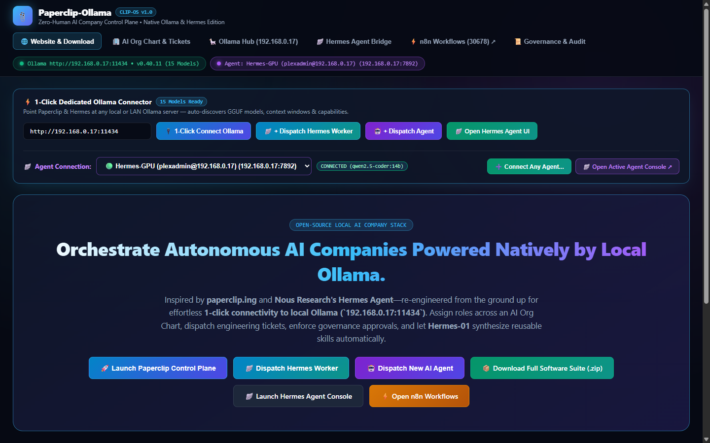
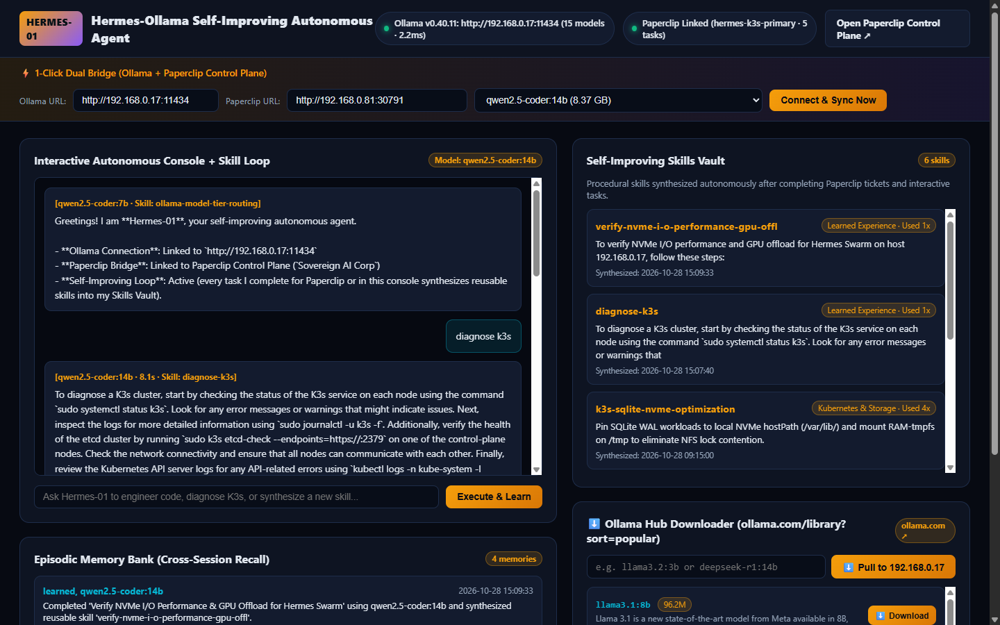
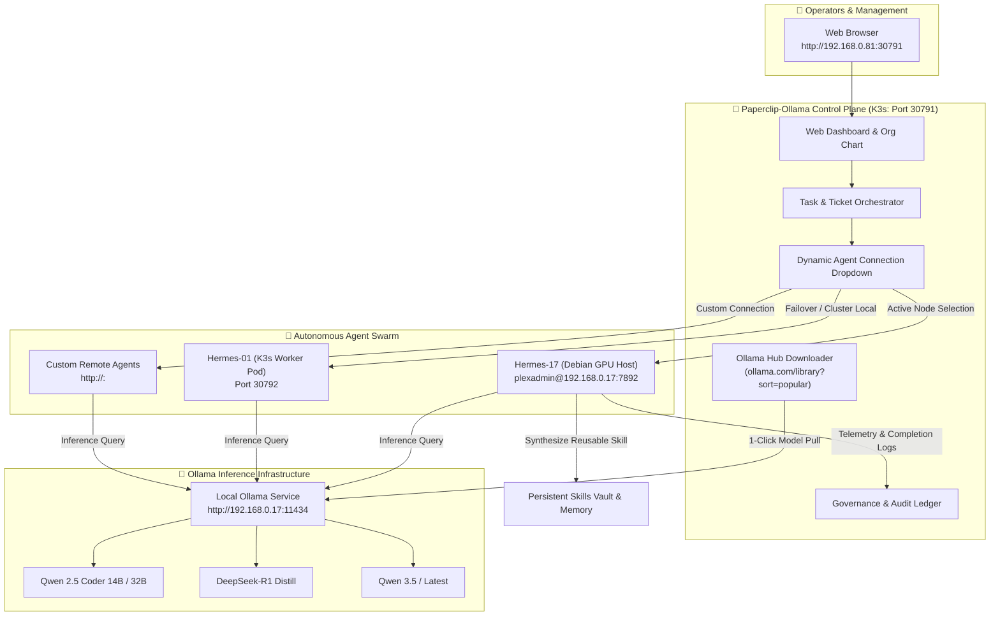

<div align="center">

# 📎 Paperclip-Ollama (`ClipOS`) & 🪽 Hermes-Agent

### Zero-Human AI Company Control Plane & Self-Improving Autonomous Worker Swarm
**Orchestrate autonomous AI companies powered natively by local Ollama instances with zero external cloud dependencies or per-token charges.**

<p align="center">
  
  
  
  
  
  
</p>

</div>

---

## 📸 Live Visual Previews

### 1. Paperclip-Ollama Control Plane (`http://192.168.0.81:30791/`)
*Interactive AI Org Chart, 1-Click Model Reassignment, Autonomous CTO Hiring, and Real-Time Ticket Stream.*



### 2. Hermes Self-Improving Agent Console (`http://192.168.0.17:7892/`)
*Bare-Metal GPU Agent on Host 17 featuring persistent Skills Vault extraction and cross-session episodic memory.*



---

## 🌟 Executive Overview

**Paperclip-Ollama** (inspired by [paperclip.ing](https://paperclip.ing/)) and **Hermes-Agent** (inspired by Nous Research's Hermes Agent) provide a complete, sovereign, on-premises AI enterprise suite. 

Unlike traditional LLM wrappers that rely on rate-limited public APIs and costly per-token billing, Paperclip-Ollama runs directly on your local hardware—pre-wired to a dedicated GPU Ollama server (`192.168.0.17:11434`) and deployed across a high-availability K3s Kubernetes cluster (`192.168.0.81 - 87`).

### Core Architecture Loop



---

## ⚡ Key Capabilities

### 1. 🏢 Visual AI Corporate Org Chart
- **Executive Hierarchy**: CEO (`Atlas`), CTO (`Vega`), Staff SRE (`Nexus`), Autonomous Worker (`Hermes-01` & `Hermes-17`), and Red-Team Auditor (`Aegis`).
- **1-Click Model Reassignment**: Point any employee to any model downloaded on your Ollama server (`qwen2.5-coder:14b`, `deepseek-r1:14b`, `llama3.3:70b`, `qwen3.5:latest`) in real-time.
- **Autonomous CTO Hiring**: Instruct the CTO (*"Hire a Kubernetes storage architect"* or *"Dispatch new Hermes worker"*); the CTO autonomously detects the hiring intent, provisions the agent persona, assigns their reporting structure, and delegates initial tasks.

### 2. 🪽 Dynamic Agent Connection Dropdown
- **Universal Multi-Node Switcher**: Seamlessly toggle between multiple Hermes or custom agent worker nodes across your LAN or cloud infrastructure from the top connection bar.
- **Host 17 Direct GPU Offload**: Runs with zero virtualization overhead directly on Debian Linux GPU host (`192.168.0.17:7892`).
- **1-Click Custom Agent Connector**: Connect to any custom agent endpoint URL; Paperclip automatically probes the node's health, discovers active models, and registers skills into the cluster.

### 3. 🧠 Self-Improving Skills Vault & Episodic Memory
- **Procedural Skill Synthesis**: Every time Hermes finishes a ticket, it analyzes its deliverable and extracts reusable procedural knowledge into its persistent JSON Skills Vault (`/data/hermes_vault.json`).
- **Episodic Context**: Maintains cross-session episodic memory to prevent repeating mistakes and accelerate execution velocity over time.
- **Completion Telemetry Logs**: Detailed execution timelines displaying task ingestion, vault priming, inference latency, token counts, and generated code artifacts.

### 4. 🔥 1-Click Popular Model Downloader (Ollama Hub)
- **Live Catalog Ingestion**: Scrapes and indexes trending models directly from `https://ollama.com/library?sort=popular` (e.g. `deepseek-r1`, `llama3.1`, `llama3.2`, `llama3.3`, `qwen2.5-coder`, `mistral`, `gemma3`).
- **Streaming Progress Bars**: Background asynchronous worker downloading GGUF layers with real-time percentage, MB/s throughput, and size telemetry.
- **Instant Model Deletion & Purging**: Free up VRAM and NVMe storage in one click.

### 5. 📱 Telegram Two-Way Agent Swarm Bridge (Target: 908-845-3667)
- **Direct Mobile Commander Link**: Connects all company agents (CEO Atlas, CTO Vega, Hermes GPU Swarm) directly to your Telegram at `908-845-3667`.
- **Outbound Deliverables**: Finished ticket outputs, execution stats, and synthesized skills are pushed directly to your Telegram chat.
- **Inbound Task Dispatch**: Send any task or message to your Telegram bot; Paperclip ingests it, delegates it to the appropriate specialist agent (or CTO), executes it via local Ollama / Hermes GPU swarm, and returns the finished deliverable directly to your chat.
- **Bot Commands**: `/status`, `/agents`, `/nodes`, `/hire <role>`.

### 6. ⚡ n8n Enterprise Workflow Automation Hub (NodePort 30678)
- **Direct Ticket-to-Workflow Engine**: Every ticket created in Paperclip triggers automated n8n workflows in the K3s cluster.
- **Active Production Workflows Created**:
  1. **Paperclip Ticket Ingestion & Swarm Dispatcher** (`/webhook/paperclip-ticket-created`): Ingests newly created tickets in real time, routes tasks to appropriate GPU compute tiers (Desktop RTX 3060, Host 17, K3s), and records audit trails.
  2. **TCK-101: K3s Autoscaling & NVMe Storage Automation** (`/webhook/tck-101-k3s-autoscaling`): Scheduled every 2 hours and on-demand to enforce SQLite NVMe storage isolation and HorizontalPodAutoscaler QoS policies designed in Ticket TCK-101.
  3. **TCK-102: RTX 3060 CUDA Hardware Benchmark** (`/webhook/tck-102-rtx3060-benchmark`): Scheduled every 6 hours and on-demand to dispatch automated CUDA benchmark telemetry jobs to `DESKTOP-EFRAIN` (RTX 3060 12GB) designed in Ticket TCK-102.
  4. **Autonomous Ticket-to-Workflow Synthesizer** (`/webhook/synthesize-workflow-from-ticket`): Automatically parses ticket requests and synthesizes active n8n automation pipelines on the fly.
- **Paperclip UI Automation Hub**: Full interactive dashboard in Paperclip (`view-n8n`) with 1-click live workflow triggering and canvas link to `http://192.168.0.81:30678`.

---

## 🗺️ Network & Service Endpoints

| Service / Node | IP & Port | Cluster Address | Role |
| :--- | :--- | :--- | :--- |
| **Paperclip Control Plane** | `http://192.168.0.81:30791` | `http://paperclip.ai.svc.cluster.local:7891` | Web UI, Org Chart, Ticket Router |
| **Hermes Agent (Desktop RTX 3060)** | `http://192.168.0.25:7892` | N/A (Outbound Work Queue) | DESKTOP-EFRAIN 12GB CUDA Worker |
| **Hermes Agent (Host 17)** | `http://192.168.0.17:7892` | N/A (Direct Host LAN) | Bare-Metal GPU Autonomous Worker |
| **Hermes Agent (K3s)** | `http://192.168.0.81:30792` | `http://hermes.ai.svc.cluster.local:7892` | Kubernetes Cluster Local Worker |
| **Ollama Backend Engine** | `http://192.168.0.17:11434` | N/A (Direct Host LAN) | 15+ GGUF LLMs (Qwen, DeepSeek, Llama) |
| **n8n Workflow Automation** | `http://192.168.0.81:30678` | `http://n8n.ai.svc.cluster.local:5678` | Autonomous Webhook & Event Automations |
| **Software Suite Bundle** | `/download/paperclip-hermes-suite.zip` | Same | Standalone 1-Click Hosted ZIP Bundle |

---

## 🚀 Quick Start Guide

### Option A: Local Workstation (Windows, Linux, macOS)

```bash
# 1. Clone repository
git clone https://github.com/ertechlab/ollamaclip.git
cd ollamaclip

# 2. Install Python dependencies
pip install -r requirements.txt

# 3. Launch Paperclip Control Plane (Port 7891)
export OLLAMA_URL="http://192.168.0.17:11434"
python paperclip_server.py

# 4. In a separate terminal, launch Hermes Autonomous Agent (Port 7892)
export OLLAMA_URL="http://192.168.0.17:11434"
export PAPERCLIP_URL="http://127.0.0.1:7891"
python hermes_agent.py
```

### Option B: High-Availability K3s Deployment

Deploy Paperclip, Hermes, and n8n natively into your Kubernetes cluster in the `ai` namespace:

```bash
# Apply Paperclip & Hermes manifests
kubectl apply -f k8s-paperclip-hermes.yaml

# Apply n8n workflow engine
kubectl apply -f k8s-n8n.yaml

# Verify pod status
kubectl -n ai get pods,svc -o wide
```

### Option C: Bare-Metal GPU Host Systemd Service (`plexadmin@192.168.0.17`)

Install Hermes as a self-healing Linux service running directly alongside Ollama:

```ini
# /etc/systemd/system/hermes-agent.service
[Unit]
Description=Hermes Agent Bridge (Host 192.168.0.17 GPU & Ollama Node)
After=network.target ollama.service

[Service]
Type=simple
User=plexadmin
WorkingDirectory=/home/plexadmin/hermes-bridge
ExecStart=/home/plexadmin/hermes-bridge-venv/bin/python /home/plexadmin/hermes-bridge/hermes_agent.py
Restart=always
RestartSec=5
Environment=PORT=7892
Environment=OLLAMA_URL=http://127.0.0.1:11434
Environment=PAPERCLIP_URL=http://192.168.0.81:30791
Environment=HERMES_SELF_URL=http://192.168.0.17:7892
Environment=NODE_ID=hermes-host-17
Environment=AGENT_NAME=Hermes-Host-17
Environment=DEFAULT_MODEL=qwen2.5-coder:14b

[Install]
WantedBy=multi-user.target
```

Enable and start:
```bash
sudo systemctl daemon-reload
sudo systemctl enable --now hermes-agent
sudo systemctl status hermes-agent
```

---

## 📡 REST API Reference

| Method | Endpoint | Description |
| :--- | :--- | :--- |
| `GET` | `/api/state` | Returns full control plane state, agents, tickets, and Ollama probe. |
| `POST` | `/api/ollama/connect` | Updates target Ollama server URL and re-probes models. |
| `POST` | `/api/tickets` | Creates and dispatches a company ticket with auto-execution. |
| `POST` | `/api/agents` | Spawns a new customized AI agent into the Org Chart. |
| `DELETE`| `/api/agents/{id}` | Decommissions an agent from active service. |
| `GET` | `/api/hermes/nodes` | Returns list of registered Hermes nodes and active selection. |
| `POST` | `/api/hermes/nodes/select` | Sets active Hermes node connection (`node_id`). |
| `POST` | `/api/hermes/nodes/connect` | Probes and registers a custom agent endpoint URL. |
| `DELETE`| `/api/hermes/nodes/{id}` | Unregisters an agent node. |
| `GET` | `/api/hermes/ticket_logs` | Returns live telemetry and completion execution logs. |
| `GET` | `/api/ollama/library` | Fetches popular models from `ollama.com/library?sort=popular`. |
| `POST` | `/api/ollama/pull` | Triggers background streaming model download. |
| `GET` | `/download/paperclip-hermes-suite.zip` | Streams compressed standalone deployment bundle. |
| `GET` | `/api/telegram` | Returns live status of Telegram bot bridge and phone pairing. |
| `POST` | `/api/telegram/config` | Saves Bot Token, Chat ID, and phone number (908-845-3667). |
| `POST` | `/api/telegram/test` | Sends live verification test alert from agents to Telegram. |

---

## 📄 License
MIT License. Built for autonomous self-improving infrastructure operations.
